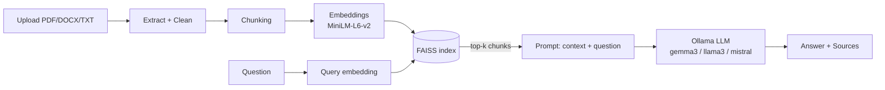

# 🧠 DocuMind AI – Intelligent Document Question Answering System

*Chat with your documents. Understand information instantly.*

DocuMind AI is a local, free, Retrieval-Augmented Generation (RAG) app. Upload PDF/DOCX/TXT files, ask questions,
get answers with page-level source citations, summarise documents and generate quizzes. No paid APIs, no API keys.

## Features
Upload (drag & drop, validation, progress) · multi-document Q&A (all / selected docs) · answers with clickable
sources · "not found" behaviour instead of hallucinating · 4 summary types × 3 lengths · quiz generator
(MCQ / True-False / Short answer, scoring + explanations) · persistent chat history (rename/delete/continue) ·
document library with statistics · keyword search with highlighting · dark/light mode · functional settings.

## Screenshots
Add your screenshots to `assets/` and link them here, e.g. ``.

## Architecture


## Workflow
Document → Text extraction → Cleaning → Chunking → Embeddings → FAISS → Similarity search → Context → LLM → Answer + Sources.
Only the retrieved chunks (never the whole document) are sent to the model.

## Technology stack
Streamlit · Python · Sentence Transformers · FAISS · pypdf · python-docx · Ollama (Gemma / Llama / Mistral).
The embedder (`modules/embeddings.py`), vector store (`modules/vector_store.py`) and LLM call
(`llm_chat` in `modules/rag_pipeline.py`) are each isolated, so they can be swapped (e.g. for ChromaDB or LangChain wrappers).

## Installation (Windows)
Requires Python 3.10+.
```bat
python -m venv .venv
.venv\Scripts\activate
pip install -r requirements.txt
copy .env.example .env
```
(macOS/Linux: `source .venv/bin/activate` and `cp .env.example .env`)

## Ollama setup
1. Install Ollama from https://ollama.com/download (Windows installer).
2. Download a model: `ollama pull gemma3` (alternatives: `llama3.2`, `mistral`). Ollama runs in the background after installation; otherwise run `ollama serve`.
3. Set `OLLAMA_MODEL` in `.env` (or change it in Settings).

## Run
```bat
streamlit run app.py
```
Open http://localhost:8501. The first upload downloads the embedding model (~90 MB) once.
Click **Load sample document** to test immediately.

## Example questions
- What is this document about? · Give me the key points. · Explain the main concept in simple words.
- What is the difference between 3NF and BCNF? · Compare normalization concepts across my selected documents.
- What is the capital of Mars? → *"I couldn't find this information in the uploaded documents."*

## Project structure
```
documind-ai/
├── app.py                  # Streamlit UI (all pages)
├── modules/                # document_processor, embeddings, vector_store, rag_pipeline,
│                           # summarizer, quiz_generator, chat_manager
├── utils/                  # file_utils (validation/registry), helpers (settings/paths)
├── data/                   # uploads/, vectorstore/, sample_document.txt, JSON registries
├── assets/                 # screenshots
├── .streamlit/config.toml  ├── requirements.txt  ├── .env.example
```

## Notes
- DOCX/TXT files have no real pages, so they are split into ~3000-character "pages" for citations.
- Scanned PDFs (images) contain no text; OCR is not included.
- Changing the embedding model requires **Settings → Rebuild index**.

## Future enhancements
OCR for scanned PDFs · hybrid (BM25 + vector) retrieval · streaming answers · user accounts · export chats · ChromaDB / LangChain backends · Docker image.

## Contributors
- _Your name(s) here_
